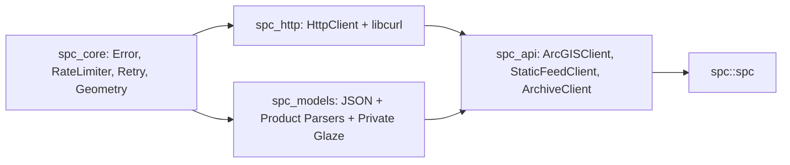
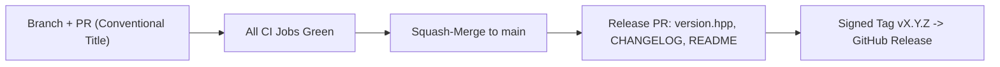

# Contributing

Thanks for helping improve `spc-cpp`! Please report security vulnerabilities privately as described in [SECURITY.md](SECURITY.md) rather than opening a public issue.

## Quick setup

```bash
git clone https://github.com/Reddimus/spc-cpp.git
cd spc-cpp

# Ubuntu 24.04 (CMake 3.31+ is required)
sudo apt install build-essential clang-format libcurl4-openssl-dev libssl-dev
sudo snap install cmake --classic

# macOS (Xcode command-line tools provide Apple Clang and libcurl)
# CI formats with clang-format 18; open a new shell after ensurepath.
brew install cmake pipx
pipx ensurepath
pipx install clang-format==18.1.8

make test
make install-hooks   # optional: runs make lint before each commit
```

Run `make help` to see all available build, test, lint, and benchmark targets.

## Project layout



Glaze is strictly internal (`src/` only) and never exposed in public `include/` headers, verified automatically by `make test-consumers`.

## Checks to run before pushing

CI checks every target below on Linux, macOS, and Windows:

```bash
make test             # Release build + unit, parity, and golden tests
make lint             # clang-format 18 check + explicit-type audit
make lint-md          # Markdown lint (requires Node.js)
make fixtures-check   # Verify tests/fixtures/SHA256SUMS
make test-consumers   # Verify install, find_package, FetchContent, and Quick Start
```

You can also run sanitizers and `clang-tidy` locally:

```bash
make test BUILD_DIR=build-asan CMAKE_ARGS=-DSPC_ENABLE_SANITIZERS=ON
make test BUILD_DIR=build-tsan CMAKE_ARGS=-DSPC_ENABLE_THREAD_SANITIZER=ON
make tidy
```

On macOS, `make tidy` needs Homebrew LLVM 18 and Homebrew curl so non-Apple Clang avoids Apple's SDK curl include conflicts:

```bash
brew install llvm@18 curl
llvm=$(brew --prefix llvm@18)
make tidy CMAKE_ARGS="-DCMAKE_CXX_COMPILER=$llvm/bin/clang++ \
  -DSPC_CLANG_TIDY_EXECUTABLE=$llvm/bin/clang-tidy -DCMAKE_PREFIX_PATH=$(brew --prefix curl)"
```

## Coding conventions

- **Formatting:** Tabs, 100 columns, enforced by `.clang-format` (`make format` applies it using `clang-format` 18).
- **Explicit types:** `tools/cpp_auto_audit.py` permits `auto` only for iterators, structured bindings, and lambdas (mark rare exceptions with `// auto-ok`).
- **No exceptions across client boundaries:** Public client methods return `spc::Result<T>` and never throw on network or parse errors.
- **Stable parser behavior:** Keep key-case fallbacks (`LABEL`/`label`/`dn`), numeric-string parsing, outer-ring-only geometry, and product-specific label mappers (each product uses its own mapper rather than sharing `severity_from_label`). `tests/golden/` guards output against unintended regressions.
- **Offline unit tests:** Test clients through `HttpTransport` or the loopback servers in [`tests/support/`](tests/support/); unit tests never hit the network.
- **ArcGIS layer contract:** If NOAA renumbers layers, update `kLayers` in [`src/api/client.cpp`](src/api/client.cpp) and [`tests/fixtures/arcgis_layers_2026-09-03.json`](tests/fixtures/arcgis_layers_2026-09-03.json) together, then run `python3 tools/verify_arcgis_metadata.py` against the live services.
- **Short comments:** Comment *why*, not *what*; keep history in commit messages and [`CHANGELOG.md`](CHANGELOG.md).

## Fixtures and golden tests

When adding or editing captured payloads in [`tests/fixtures/`](tests/fixtures/), document the source in [`tests/fixtures/README.md`](tests/fixtures/README.md), update checksums, and add or update the matching golden snapshot:

```bash
# Update fixture checksums
find tests/fixtures -type f ! -path '*/.*' ! -path tests/fixtures/README.md \
  ! -path tests/fixtures/SHA256SUMS -exec shasum -a 256 {} + |
  LC_ALL=C sort -k 2 > tests/fixtures/SHA256SUMS
make fixtures-check

# Update golden snapshots when an output change is intentional, then inspect the diff
cmake --build build
SPC_UPDATE_GOLDEN=1 ./build/tests/spc_tests --gtest_filter='Parsers/Golden.*'
git diff tests/golden
```

## Benchmarks

`make bench` builds and runs Google Benchmark in `build-bench` (`BENCH_ARGS=--benchmark_filter=BM_Parse` filters cases). Each benchmark reports warm heap stats (`allocs`, `alloc_bytes`, `peak_bytes`, `retained_bytes`) and `instructions` on macOS. To compare two branches accurately, run interleaved repetitions and `compare.py` (requires `numpy` and `scipy`):

```bash
args="--benchmark_repetitions=10 --benchmark_enable_random_interleaving=true"
git switch main && make bench BENCH_ARGS="$args --benchmark_out=build-bench/main.json"
git switch my-branch && make bench BENCH_ARGS="$args --benchmark_out=build-bench/branch.json"
python3 build-bench/_deps/benchmark-src/tools/compare.py benchmarks \
  build-bench/main.json build-bench/branch.json
```

## Pull requests and releasing



- **Pull requests:** Branch from `main`, use a conventional-commit title (e.g., `fix(api): ...`), record user-visible changes under `[Unreleased]` in [`CHANGELOG.md`](CHANGELOG.md), and ensure CI passes before squash-merging.
- **Releasing:**
  1. Open a PR updating [`include/spc/version.hpp`](include/spc/version.hpp), dating a `[X.Y.Z] - YYYY-MM-DD` section in [`CHANGELOG.md`](CHANGELOG.md), and updating `GIT_TAG` (and `find_package` on minor bumps) in [`README.md`](README.md). Verify with `make test-consumers`.
  2. After merging, tag `main` (`git tag -s vX.Y.Z -m "Release X.Y.Z" && git push origin vX.Y.Z`). The release workflow validates the tag against `version.hpp`, runs tests and consumer checks, and publishes the matching changelog notes.
- **Private vulnerability reporting:** Keep GitHub private vulnerability reporting enabled under repository Security settings (`gh api repos/Reddimus/spc-cpp/private-vulnerability-reporting`).
