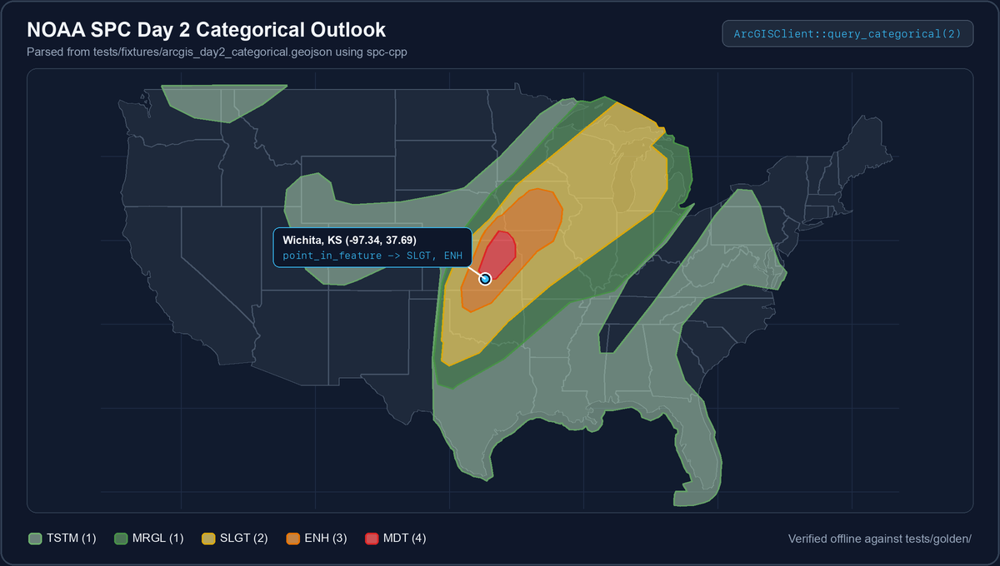
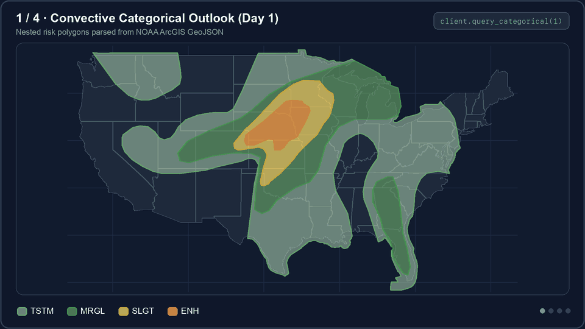
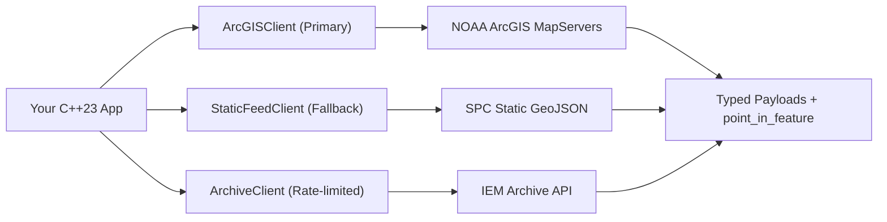
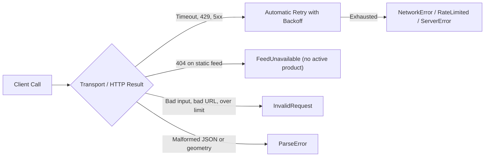

# spc-cpp

[](https://github.com/Reddimus/spc-cpp/actions/workflows/ci.yml)
[](https://github.com/Reddimus/spc-cpp/releases)
[](https://en.cppreference.com/cpp/23)
[](LICENSE)

A lightweight C++23 client for NOAA Storm Prediction Center (SPC) severe-weather data: convective and fire-weather outlooks, mesoscale discussions, watches, and local storm reports. It reads [NOAA's ArcGIS services](https://mapservices.weather.noaa.gov/vector/rest/services/), [SPC's static GeoJSON feeds](https://www.spc.noaa.gov/gis/), and the [Iowa Environmental Mesonet (IEM)](https://mesonet.agron.iastate.edu/api/) archive with no API key required.



## Quick start

Save this as `main.cpp` to fetch today's categorical outlook and check whether Wichita is inside any risk band:

```cpp
#include "spc/spc.hpp"

#include <iostream>

int main() {
    const spc::ArcGISClient client;
    const spc::Result<spc::CategoricalOutlookPayload> day1 = client.query_categorical(1);
    if (!day1) {
        std::cerr << day1.error().message << "\n";
        return 1;
    }
    std::cout << "Day 1 bands: " << day1->features.size() << "\n";
    for (const spc::OutlookFeature& band : day1->features) {
        if (spc::point_in_feature(-97.34, 37.69, band)) { // lon, lat of Wichita
            std::cout << "Wichita is in " << band.label << "\n";
        }
    }
}
```

Day 1 is today's outlook (`Day 1 bands: 0` is normal on a quiet day).

## Supported products





| Product | Call |
| --- | --- |
| Categorical outlook, days 1-3 | `ArcGISClient::query_categorical(day)` |
| Probabilistic outlook, days 1-3 | `ArcGISClient::query_probabilistic(day, hazard)` |
| Conditional intensity, days 1-3 | `ArcGISClient::query_conditional_intensity(day, hazard)` |
| Severe outlook, days 4-8 | `ArcGISClient::query_day4_8(day)` |
| Fire weather, days 1-8 | `ArcGISClient::query_fire_weather(day)` |
| Active mesoscale discussions | `ArcGISClient::query_active_md()` |
| Any ArcGIS layer as raw JSON | `ArcGISClient::query_layer(service, layer_id, params)` |
| Watches, current or historical | `ArchiveClient::watches(timestamp)` |
| Storm reports between two times | `ArchiveClient::storm_reports(start, end, office)` |

- `hazard` is `"tornado"`, `"hail"`, or `"wind"` on days 1-2, and `"severe"` on day 3.
- `StaticFeedClient::day_categorical`, `day_probabilistic`, and `day4_8` fetch the same outlooks from SPC's GeoJSON files as a fallback.
- `ArchiveClient` enforces a polite IEM limit (burst of 2 requests, then 1 per second); share one instance across your app. See [`include/spc/api.hpp`](include/spc/api.hpp) for full signatures.

## Install and build

**Requirements:** CMake 3.31+ (`sudo snap install cmake --classic` on Ubuntu 24.04), a C++23 compiler (GCC 13+, Clang 18+ with libc++ or 19+ with libstdc++, Apple Clang 17+, or MSVC), and libcurl 7.86+ (`libcurl4-openssl-dev` on Ubuntu, built into macOS, or via the included `vcpkg.json` manifest on Windows).

### Option 1: CMake FetchContent

Add this to `CMakeLists.txt` next to `main.cpp`:

```cmake
cmake_minimum_required(VERSION 3.31)
project(myapp LANGUAGES CXX)
include(FetchContent)
FetchContent_Declare(spc_cpp
    GIT_REPOSITORY https://github.com/Reddimus/spc-cpp.git
    GIT_TAG v0.4.12
)
FetchContent_MakeAvailable(spc_cpp)
add_executable(myapp main.cpp)
target_link_libraries(myapp PRIVATE spc::spc)
```

Build and run:

```bash
cmake -S . -B build
cmake --build build --parallel
./build/myapp
```

### Option 2: Install and `find_package`

```bash
cmake -S . -B build -DCMAKE_BUILD_TYPE=Release -DSPC_BUILD_TESTS=OFF
cmake --build build --parallel
cmake --install build --prefix /your/prefix
```

```cmake
find_package(spc 0.4 REQUIRED)
target_link_libraries(myapp PRIVATE spc::spc)
```

Configure your consumer with `-DCMAKE_PREFIX_PATH=/your/prefix`. Pre-1.0 minor releases can change the API, so `0.4` matches `0.4.x` releases.

### Platform notes

- **Windows:** Configure with `-DCMAKE_TOOLCHAIN_FILE=<vcpkg>/scripts/buildsystems/vcpkg.cmake`, build with `--config Release`, and test with `ctest --test-dir build -C Release`.
- **macOS:** Add `-DCMAKE_OSX_DEPLOYMENT_TARGET=13.4` to target older macOS releases, or `-DCMAKE_OSX_ARCHITECTURES="arm64;x86_64"` with the system libcurl for a universal binary.
- **Installed downstream libraries:** Set `set(SPC_INSTALL ON)` before `FetchContent_MakeAvailable(spc_cpp)` so `install(EXPORT)` includes `spc-cpp` targets.

## Errors and offline parsing

Client calls return `spc::Result<T>` (`std::expected<T, spc::Error>`) and never throw on network or data errors.



| Code | Meaning |
| --- | --- |
| `NetworkError` | Connection, TLS, or timeout failure after retries. |
| `RateLimited` | HTTP 429/503 after retries, or `ArchiveClient` wait limit (> 5 s) exceeded. |
| `ServerError` | HTTP 5xx (other than 503), redirect loop, or non-converging ArcGIS paging. |
| `InvalidRequest` | Invalid arguments, non-HTTP(S) URL, blocked HTTPS-to-HTTP redirect, HTTP 400, ArcGIS error, or payload > 64 MiB. |
| `NotFound` | Retired URL or ArcGIS service path. |
| `FeedUnavailable` | `StaticFeedClient` only: SPC has not issued this product yet (normal outside active windows). |
| `ParseError` | Malformed JSON, unconvertible Esri geometry, or allocation failure. |
| `Unknown` | Any other HTTP status (in `Error::http_status`), such as 422 on a bad `ArchiveClient` timestamp. |

ArcGIS errors returned inside HTTP 200 JSON bodies are handled automatically (429 and 5xx are retried per page).

You can also parse payloads directly offline via `spc::parse_categorical`, `spc::parse_probabilistic`, `spc::parse_conditional_intensity`, `spc::parse_day4_8`, `spc::parse_fire_weather`, `spc::parse_mesoscale_discussions`, `spc::parse_watches`, and `spc::parse_storm_reports`. They throw `std::runtime_error` on malformed JSON or invalid Esri geometry.

- **Coordinates:** Returned as `(lon, lat)` degrees. Esri Web Mercator (`3857`, `102100`, `102113`) is converted to degrees within 1 m accuracy; `4326`, `4269`, and unreferenced data are kept as degrees. Other spatial references fail (pass `outSR=4326` for custom `query_layer` calls).
- **Resource bounds:** With `HttpClient`, decoded responses are capped at `ClientConfig::max_response_bytes` (64 MiB default; `0` disables the cap), shared across all pages and layers of an `ArcGISClient` call. Custom transports must bound individual responses themselves (`ArcGISClient` applies a 64 MiB paging budget across pages without refusing the first response), and offline `parse_*` functions have no byte cap. Projected edge expansion is capped at 1,000,000 added points per payload (shared across all pages and layers of an `ArcGISClient` call).

## Configuration and threads

Use `spc::ClientConfig` to set a custom user agent, request timeout (15 s default), or max response size (64 MiB default):

```cpp
const spc::ArcGISClient client{
    spc::ClientConfig{.user_agent = "myapp/1.0 (you@example.com)"}
};
```

Default clients are thread-safe, and each instance owns its own pooled libcurl transport; pass a shared `std::shared_ptr<spc::HttpClient>` to reuse one pool across multiple clients. To plug in your own HTTP client or mock responses in tests, implement `spc::HttpTransport` (concurrent `get` calls must be thread-safe):

```cpp
struct MyTransport final : spc::HttpTransport {
    spc::Result<spc::HttpResponse> get(std::string_view url) const override;
};
const spc::ArcGISClient client{std::make_shared<MyTransport>()};
```

## Examples

Run any [example](examples/) directly from a build: `make run-parse_outlook` (offline), `make run-arcgis`, `make run-static_feed`, `make run-fire_weather`, `make run-archive`, or `make run-watches`.

## Contributing and security

See [CONTRIBUTING.md](CONTRIBUTING.md) to set up a dev environment and run checks, and [SECURITY.md](SECURITY.md) for reporting vulnerabilities.

## License

[MIT](LICENSE)
