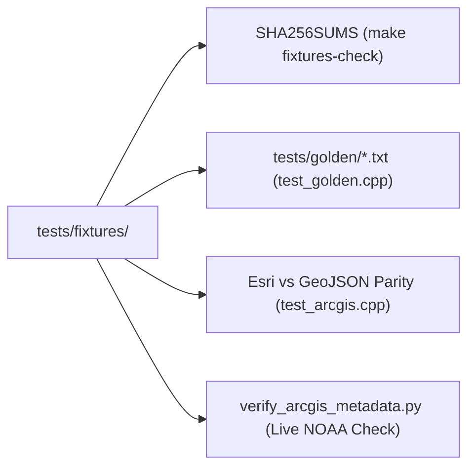

# Test fixtures

Real payloads captured from NOAA, SPC, and IEM services (mostly on 2026-05-17). Files ending in `.synthetic.json` cover states with no live data at capture time.

## SPC static GeoJSON (`www.spc.noaa.gov`)

- `day{1,2,3}otlk_cat.nolyr.geojson`: categorical outlooks with uppercase `LABEL`, `ISSUE`, `VALID`, `EXPIRE`, and `Polygon` / `MultiPolygon` geometry.
- `day4prob.nolyr.geojson`: Day 4 probability (`LABEL` string `"0.15"`).
- `spc_404_no_active_outlook.html`: HTTP 404 HTML page returned when a product is not issued.

## NOAA ArcGIS (`mapservices.weather.noaa.gov`)

Matched Esri JSON (`.esri.json`, `f=json`) and GeoJSON (`.geojson`, `f=geojson`) pairs for geometry parity tests:

- `arcgis_day{1,2,3}_categorical`
- `arcgis_day1_prob_{tornado,hail,wind}` and `arcgis_day2_prob_wind` (lowercase fields, fractional `label` such as `"0.02"`)

Single captures and contract files:

- `arcgis_day1_torn_conditional_intensity.esri.json`: conditional intensity (`"CIG1"`).
- `arcgis_day{1,2}_fire_weather.esri.json`: native Web Mercator (`wkid: 102100`) polygons with numeric `dn` bands and no `label`/`issue`, testing Mercator-to-degree conversion.
- `arcgis_mesoscale_discussion.esri.json`: active mesoscale discussion.
- `arcgis_mesoscale_discussion_noarea.esri.json`: `NoArea` placeholder returned when no discussion is active (2026-09-25).
- `arcgis_layers_2026-09-03.json`: layer IDs, names, and parent IDs for all three MapServers, verified live by `python3 tools/verify_arcgis_metadata.py`.

Synthetic:

- `arcgis_day4_8_nonempty.synthetic.json`: non-empty Day 4 ArcGIS response.

## IEM archive (`mesonet.agron.iastate.edu`)

- `iem_storm_reports.json`: Local Storm Reports (`Point` geometry).
- `iem_spc_watch.json`: historical SPC watches.
